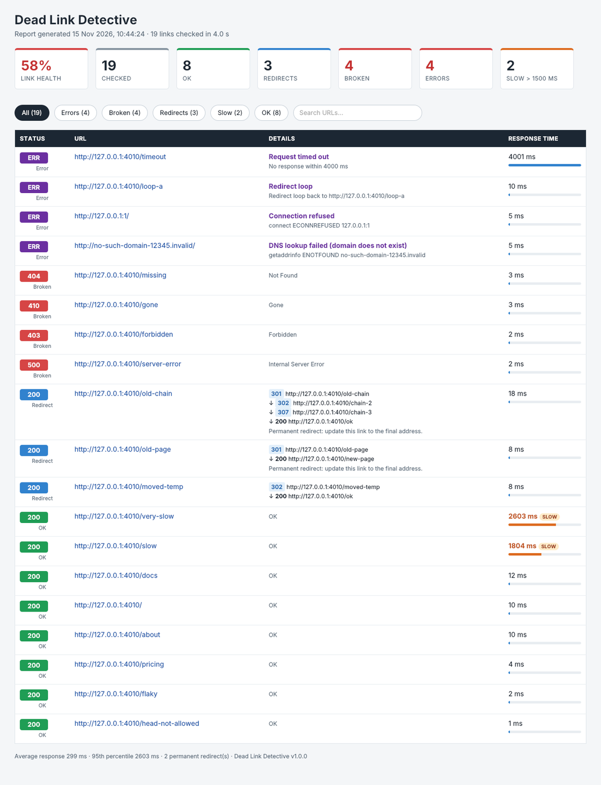

# Dead Link Detective

**Finds broken links before your users do.**

Give it a list of URLs. It checks every one concurrently and produces a report of status codes, slow responses and redirects, as a coloured terminal summary plus JSON, CSV and HTML files.

- Zero dependencies: only Node.js built-in modules (`http`, `https`, `fs`, `events`, `stream`, `zlib`, `crypto`, `url`, `util` ...).
- Requires Node.js 18.17 or newer (developed on Node 22).



## Quick start

```bash
git clone https://github.com/your-username/dead-link-detective.git
cd dead-link-detective

npm run demo                      # no internet needed: checks a local site that misbehaves on purpose
node src/cli.js check urls.txt    # check the sample list (needs internet)
node src/cli.js serve             # open the latest report at http://localhost:3000
npm test                          # 40 automated tests
```

## Usage

```text
dead-link-detective check <file|url> [more files or urls] [options]
dead-link-detective serve [options]
cat urls.txt | dead-link-detective check -
```

| Option | Meaning | Default |
| --- | --- | --- |
| `-c, --concurrency <n>` | Requests in flight at once | 10 |
| `--per-host <n>` | Max simultaneous requests to one host | 3 |
| `-t, --timeout <ms>` | Give up on a request after | 8000 |
| `-s, --slow <ms>` | Flag responses slower than | 1500 |
| `-r, --retries <n>` | Retries for transient failures (429, 502, 503, 504, connection reset) | 1 |
| `--max-redirects <n>` | Redirect hops to follow | 5 |
| `--method <HEAD\|GET>` | First request method | HEAD |
| `--no-redirects` | Report 3xx answers instead of following them | off |
| `--insecure` | Accept invalid TLS certificates | off |
| `-f, --format <list>` | `json,csv,html` | all |
| `-o, --out <dir>` | Report folder | `./reports` |
| `--gzip` | Compress report files | off |
| `--no-report` | Do not write files | off |
| `-q, --quiet` | Only show the summary | off |
| `--fail-on-broken` | Exit with code 1 if any link is broken or failing (for CI) | off |
| `--no-color` | Plain output | off |
| `-p, --port <n>` | Port for `serve` | 3000 |

**Input file format:** one URL per line. Blank lines and `# comments` are ignored, the scheme is optional (`example.com` becomes `https://example.com/`), and duplicates are removed.

**Exit codes:** `0` finished, `1` broken links found (with `--fail-on-broken`), `2` usage or runtime error.

## What gets reported

| Category | Meaning |
| --- | --- |
| **ok** | Clean 2xx answer |
| **redirect** | One or more redirects were followed. Permanent ones (301/308) are listed under "Update these" |
| **broken** | The server answered 4xx or 5xx |
| **error** | No usable answer: DNS failure, connection refused, timeout, TLS problem, redirect loop, too many redirects |
| **slow** (flag) | Response time above the `--slow` threshold |

Response time is the time until the server's response headers arrive, summed over all redirect hops. Bodies are never downloaded.

### Smart behaviour

- **HEAD first, GET fallback.** HEAD is cheap, but some servers answer it wrongly. Any HEAD answer of 400 or more is confirmed with a GET before the link is called broken.
- **Redirect chains** are followed and recorded hop by hop, with loop detection and a hop limit.
- **Retries** with exponential back-off for transient failures. Timeouts are not retried.
- **Politeness:** a per-host limit stops the tool from hammering one server even at high concurrency.
- **Graceful Ctrl+C:** stops scheduling, finishes in-flight requests and still writes a partial report.

## Report server

`node src/cli.js serve` publishes the newest report:

| Route | Returns |
| --- | --- |
| `/` | HTML dashboard |
| `/api/summary` | Totals and health score |
| `/api/results` | All results. Filters: `?category=broken`, `?status=404` or `?status=4xx`, `?slow=true`, `?q=text`, `?sort=time`, `?limit=10` |
| `/health` | Liveness check |

## Use it as a library

```js
import { DeadLinkDetective } from './src/index.js';

const detective = new DeadLinkDetective({ concurrency: 20, timeout: 5000 });
detective.on('result', ({ result, done, total }) => console.log(`${done}/${total}`, result.status, result.url));
const report = await detective.run(['https://example.com/', 'https://nodejs.org/']);
console.log(report.summary);
```

A callback version of the single-URL checker is also available: `checkUrlCallback(url, options, (err, result) => {})`.

## Project structure

```text
dead-link-detective/
  package.json
  urls.txt               sample input list
  src/
    cli.js               command line entry point (check, serve)
    detective.js         DeadLinkDetective class (EventEmitter, orchestrates a run)
    checker.js           HTTP/HTTPS client: redirects, retries, timeouts, HEAD->GET
    pool.js              runPool() concurrency limiter and Semaphore
    classify.js          status classification and friendly error labels
    summary.js           totals, averages, percentiles, health score
    urlList.js           reads, validates and de-duplicates URLs (streams)
    config.js            defaults and option validation
    server.js            report web server and JSON API
    index.js             public library exports
    reporters/           console, json, csv, html, io (atomic file writing)
    utils/colors.js      ANSI colours
  demo/                  local misbehaving test site and demo runner
  test/                  automated tests (node:test)
  docs/                  project documentation and screenshots
```

## Limitations

- Checks the URLs you give it; it does not crawl a site to discover links.
- Does not run JavaScript, so links that only exist after client-side rendering are out of scope.
- Some sites block automated clients (403/429). Lower `--concurrency` or raise `--timeout` if that happens.

## Licence

MIT
